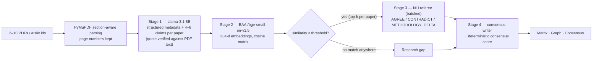

# Kairos

**Multi-paper literature synthesis and contradiction engine, built on open-weight models.**


> *AI belongs to everyone. Build for a world you understand. Make it open.* — OPEN//BUILD 2026, organised by Open Source Community Africa (OSCA) Ile-Ife.

**Built with Llama & Open-Weight Models.** Kairos uses Meta Llama 3.1 / 3.2 models under their community licences, plus Apache-2.0 (`Qwen3.8-27B`) and MIT (`BAAI/bge-small-en-v1.5`) licensed models. See the [model and licence table](#open-weight-models-and-licence-compliance).

**Live Production Backend API:** [https://kairos-yo50.onrender.com](https://kairos-yo50.onrender.com) · **Interactive Swagger Docs:** [https://kairos-yo50.onrender.com/docs](https://kairos-yo50.onrender.com/docs) · **Health Status:** [https://kairos-yo50.onrender.com/api/v1/health](https://kairos-yo50.onrender.com/api/v1/health)

---

## The problem and who it is for

**Users:** university students writing literature reviews and final-year theses, and early-career researchers.

When you compare 6 to 8 papers on one topic you end up with dozens of PDF tabs, scattered notes and a nagging question: *why does Paper A report 94% while Paper D reports 61%?* Existing "chat with PDF" tools blur claims across documents, invent citations, and stop working beyond two files. Students at under-resourced institutions also cannot rely on paid closed-model subscriptions.

## What Kairos does

Drop **2 to 10 PDFs** (or paste arXiv ids). Kairos returns three views, each claim anchored to a **verified verbatim quote and page number**:

1. **Synthesis matrix** — datasets, sample sizes, methods, metrics, limitations and conclusions side by side, with one paper **pinned as a baseline** while the others scroll.
2. **Contradiction graph** — claims as nodes; **green** edges where papers agree, **red** where they contradict, **amber** where results differ because of methodology (different data, hardware or conditions). Click any edge for the two quotes and the referee's explanation. Filter by topic cluster, paper or "isolate contradictions".
3. **Consensus and gaps** — a consensus score, top contradictions, **research gaps** (claims no other paper addresses) and a one-click **Markdown / LaTeX literature-review export**.

## How it scales to 6–8+ papers

Naively comparing every claim with every other claim is quadratic: 8 papers × 5 claims = 40 claims, **700 cross-paper pairs**, each needing an LLM call. Kairos embeds claims with an open embedding model and only asks the LLM about pairs that are semantically close.



The API reports the real numbers for every run (`cross_paper_pairs_total`, `candidate_pairs`, `pair_reduction_pct`, `referee_calls`). We **measure** the reduction rather than assume it.

## Open-weight models and licence compliance

| Role | Model | Where it runs | Licence | Notes |
| :--- | :--- | :--- | :--- | :--- |
| Extraction, referee, consensus writer (primary) | `meta-llama/Llama-3.1-8B-Instruct` | Groq (`llama-3.1-8b-instant`) → Hugging Face Inference | Llama 3.1 Community License | Attribution: "Built with Llama" |
| Primary / Regional Fallback LLM | `Qwen/Qwen3.8-27B` (`qwen/qwen3.8-27b`) / `Qwen/Qwen2.5-7B-Instruct` | Groq / Hugging Face Inference | Apache-2.0 | Auto-fallback & configurable via env |
| Offline fallback LLM | `meta-llama/Llama-3.2-3B-Instruct` (`llama3.2:3b`) | Local Ollama | Llama 3.2 Community License | Runs on a laptop, no internet |
| Embeddings | `BAAI/bge-small-en-v1.5` | Local (FastEmbed / ONNX) | MIT | 33M parameters, 384 dimensions |

"Open weights" does not mean unrestricted. We do not redistribute weights, we show the attribution notice in the UI footer and this README, and we follow each licence's usage terms. Provider fallback order is configurable (`LLM_PROVIDER_CHAIN`). **No closed model (OpenAI, Anthropic, Gemini) is called by the application.** Details and known limitations: [`docs/shared/03-open-weight-models.md`](docs/shared/03-open-weight-models.md).

## Monorepo layout

```
kairos/
├── AGENTS.md              # rules every coding agent reads first
├── DESIGN.md              # design system (frontend baseline)
├── MASTER_PROMPTS.md      # bootstrap prompts for agents and the Argon 4 review gate
├── LICENSE                # MIT
├── backend/               # FastAPI + PyMuPDF + open-weight pipeline  (owner: DuroT)
├── frontend/              # Vanilla HTML5 + CSS3 + JS + Cytoscape.js   (owner: Peace)
├── fixtures/              # pre-analysed presets + contract sample     (owner: DuroT)
└── docs/
    ├── shared/            # architecture, API contracts, model strategy
    ├── duro/  peace/      # per-developer execution playbooks
    ├── reviews/           # Local Argon 4 AI review text bundles (ignored by git)
    ├── requests.md        # cross-developer contract change log
    └── AI_ASSISTANCE.md   # AI-assistance disclosure log
```

## Reproducible local setup (about 5 minutes)

Prerequisites: Python 3.11+, a free [Groq](https://console.groq.com) API key **or** a Hugging Face token **or** [Ollama](https://ollama.com) with `llama3.2:3b` pulled.

```bash
git clone https://github.com/taiwodurotoluwa-svg/kairos.git
cd kairos

# 1) Backend
cd backend
python -m venv venv
venv\Scripts\activate            # Windows PowerShell   (macOS/Linux: source venv/bin/activate)
pip install -r requirements.txt
copy .env.example .env           # macOS/Linux: cp .env.example .env ; then add GROQ_API_KEY or HF_TOKEN
python -m scripts.sync_fixtures  # mirrors /fixtures/*.json into /frontend/fixtures/
uvicorn app.main:app --reload --port 8000

# 2) Frontend (new terminal from repo root — zero-build Vanilla HTML5/CSS3/ES6)
python -m http.server 5500 --directory frontend   # http://localhost:5500 (or VS Code Live Server on :5500)
```

Presets work with **no API key at all**: choose a preset in the UI. Live analysis needs one provider configured.

Run the tests:

```bash
cd backend && pytest -v
python -m scripts.verify_fixture_quotes
```

> Status: this README describes the target product. Milestone progress is tracked in the playbooks under `docs/duro/` and `docs/peace/`. Where a step above is not merged yet, the playbook for that milestone is authoritative.

## Demo Day guide (8-minute slot: 3 min slides + 5 min live)

| Time | What we show |
| :--- | :--- |
| 0:00–1:00 | Problem and user: a student with 8 PDFs and one question |
| 1:00–3:00 | Slides: the 4-stage open-weight pipeline, the O(N²) pre-filter, why open weights |
| 3:00–4:00 | **Preset (0 latency):** Radiology, 8 papers. Pin a baseline, show a red edge and open the dispute drawer (quote + page + explanation) |
| 4:00–5:30 | **Live upload** of 2–3 fresh PDFs while narrating the progress stepper |
| 5:30–7:00 | Consensus score, research gaps, export to Markdown |
| 7:00–8:00 | Open-source practice: MIT, licences, reproducibility, limitations, next steps |

Fallbacks: if the network or provider fails, switch to the presets (always work offline) and show the recorded fallback video.

## Limitations (honest)

- Small models can mislabel relations; every verdict ships with both quotes so users can check. Treat Kairos as a **reading aid, not a source of truth**.
- Scanned PDFs without a text layer are rejected (no OCR). Tables, figures and equations are not parsed.
- English-language papers only.
- Consensus score is a transparent ratio of edge types, not a statistical meta-analysis.
- Free-tier model APIs are rate limited; analysis time varies.

## Team

| Name | Role | GitHub |
| :--- | :--- | :--- |
| Durotoluwa Taiwo (DuroT) | Backend, open-weight pipeline | [@taiwodurotoluwa-svg](https://github.com/taiwodurotoluwa-svg) |
| Oluwanifemi (Peace) | Frontend, UX and design | [@Peaceyy28](https://github.com/Peaceyy28) |

## AI-assisted contributions acknowledgement

We built Kairos with AI coding agents (Antigravity with Claude and Gemini models) under human direction, and used **Gemini Argon 4 (Google AI Studio)** as an independent code-review gate before every merge. Both teammates review and can explain every file. A milestone-by-milestone record is in [`docs/AI_ASSISTANCE.md`](docs/AI_ASSISTANCE.md); review evidence is in [`docs/reviews/`](docs/reviews/).

## Licences, datasets and acknowledgements

- Kairos source code: **MIT** (see [`LICENSE`](LICENSE)).
- Models: see the table above. Llama 3.1 / 3.2 are under their respective Meta community licences.
- Libraries: FastAPI, Pydantic, PyMuPDF (AGPL-3.0 / commercial, used here as a dependency for a non-commercial hackathon prototype; review before commercial redistribution), FastEmbed, scikit-learn, Cytoscape.js.
- Demo presets are built from real, openly licensed papers listed in `fixtures/presets_manifest.json` (added in D5). No PDFs are committed unless their licence allows redistribution.
