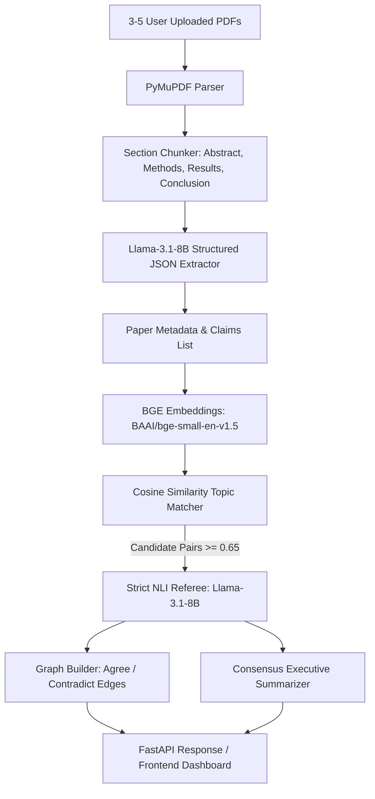

# 01-Architecture & End-to-End Pipeline

This document defines the technical data pipeline for **Kairos**.

## Step 1: Ingestion & Section-Aware Extraction (PyMuPDF)
* Extracts text from uploaded PDFs while preserving page numbers.
* Identifies key sections: `Abstract`, `Methodology / Approach`, `Results / Evaluation`, and `Discussion / Conclusion`.
* Discards boilerplate (references, index, acknowledgements) to keep prompt context concise and avoid noise.

## Step 2: Structured Open-Weight Extraction (Llama-3.1-8B)
* Converts raw text into a strict Pydantic JSON object per paper:
  * Title, Authors, Year
  * Dataset details (sample size $n$, source, cleanliness)
  * Methodology (architecture, baseline comparison)
  * Key numeric metrics (accuracy, F1, latency, error rate)
  * Atomic claims (concise statements of fact or conclusion + verbatim quotation + page number).

## Step 3: Semantic Topic Clustering (BAAI/bge-small-en-v1.5)
* Instead of comparing every claim against every other claim ($O(N^2)$ LLM calls), each claim is embedded using open-source BGE embeddings.
* Claims across different papers are grouped by cosine similarity.
* Only claim pairs discussing the same topical variable (cosine similarity $\ge 0.65$) are passed to the referee.

## Step 4: Strict NLI Referee (Natural Language Inference)
* The candidate pair (Claim A from Paper 1 and Claim B from Paper 2) is sent to `Llama-3.1-8B-Instruct` or `Llama-3.2-3B-Instruct`.
* Prompted strictly for:
  * **`AGREE` (Entailment):** Both papers reach compatible findings.
  * **`CONTRADICT` (Conflict):** Findings directly diverge or conflict.
  * **`UNRELATED` (Neutral):** Different experimental scope.
* For every `CONTRADICT`, the model outputs a 1–2 sentence **Reason for Difference** (e.g., sample size bias, lab vs. in-the-wild evaluation, different evaluation metrics).

## Step 5: Graph & Consensus Synthesis
* Construct nodes (Papers and Claims) and edges (`AGREE` = Green, `CONTRADICT` = Red).
* Generate a cross-paper **Consensus Report** summarizing universal truths and active scientific debates.
