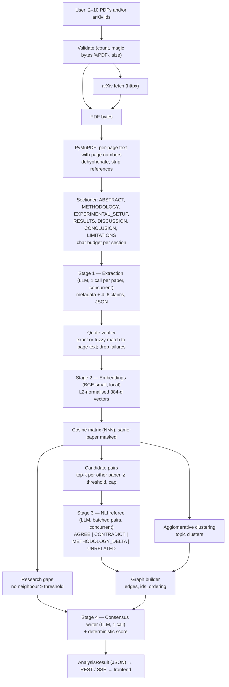

# 01 — System Architecture

End-to-end design of Kairos: ingestion, four model stages, graph construction, latency budget and failure handling. Field names refer to [`02-api-contracts.md`](02-api-contracts.md); prompts and model ids are in [`03-open-weight-models.md`](03-open-weight-models.md).

## 1. Dataflow



Presets bypass the whole pipeline: `GET /api/v1/demo/{preset_id}` returns a pre-baked `AnalysisResult` from `/fixtures`.

## 2. Ingestion

### 2.1 Validation
- Count: 2–10 papers after de-duplication (by arXiv id and by SHA-256 of file bytes).
- A file is a PDF only if its first 5 bytes are `%PDF-` (extension alone is not trusted).
- Size: ≤ `MAX_FILE_MB` per file, ≤ `MAX_TOTAL_MB` per request.

### 2.2 arXiv
Accepted forms: `2401.01234`, `2401.01234v2`, `arxiv.org/abs/2401.01234`, `arxiv.org/pdf/2401.01234v2(.pdf)`, old-style `cs.CL/0501001`. Normalise to the bare id (version kept if present). Download `https://arxiv.org/pdf/{id}` with `httpx.AsyncClient`, `User-Agent: Kairos/1.0 (OPEN//BUILD hackathon; contact via GitHub)`, timeout 30 s, `follow_redirects=True`, concurrency `ARXIV_CONCURRENCY` (default 3). Reject responses that do not start with `%PDF-`.

### 2.3 Text extraction (PyMuPDF)
- For each page: `page.get_text("text", sort=True)` (`sort=True` keeps two-column reading order reasonable).
- Remove soft hyphenation: `re.sub(r"-\n(?=[a-z])", "", text)`; collapse single newlines inside paragraphs to spaces but keep blank-line paragraph breaks.
- Keep a dict `page_texts: dict[int, str]` (1-indexed). **This cleaned text is the canonical source** for both the LLM input and quote verification.
- **Scanned PDF check:** if the mean extractable characters per page is < 200, raise `NO_TEXT_LAYER` for that paper.
- Metadata hints: PyMuPDF `doc.metadata` title/author are used only as hints; the LLM extraction is authoritative.

### 2.4 Section detection
Heading regex (line-anchored, case-insensitive), optional numbering such as `3.`, `3.1`, `III.`:

```
^\s*(?:\d+(?:\.\d+)*\.?|[IVX]+\.)?\s*(abstract|introduction|related work|background|method(?:s|ology)?|approach|materials and methods|experimental setup|experiments?|implementation details|results?|evaluation|discussion|conclusions?|limitations?|future work|references|bibliography|acknowledg(?:e)?ments?)\s*$
```

Mapping to `SectionName`:

| Heading(s) | SectionName |
| :--- | :--- |
| abstract | `ABSTRACT` |
| method, methods, methodology, approach, materials and methods | `METHODOLOGY` |
| experimental setup, experiment(s), implementation details | `EXPERIMENTAL_SETUP` |
| result(s), evaluation | `RESULTS` |
| discussion | `DISCUSSION` |
| conclusion(s), future work | `CONCLUSION` |
| limitation(s) | `LIMITATIONS` |
| introduction, related work, background | `OTHER` (kept only as overflow, lowest priority) |
| references, bibliography, acknowledgements | **stop**: discard everything from here on |

Text before the first heading on page 1 is treated as `ABSTRACT` (up to 3000 chars).

### 2.5 Character budget per paper (`MAX_PAPER_CHARS = 24000` ≈ 6k tokens)

| Group | Budget | Truncation |
| :--- | :--- | :--- |
| `ABSTRACT` | 3000 | keep head |
| `METHODOLOGY` + `EXPERIMENTAL_SETUP` | 7000 | split evenly, keep head of each |
| `RESULTS` | 8000 | keep head |
| `DISCUSSION` + `CONCLUSION` + `LIMITATIONS` | 6000 | split evenly, keep head of each |

If no headings are detected, fall back to head/tail: first 6000 chars (labelled `ABSTRACT`) and last 18000 chars before references (labelled `OTHER`), and omit those sections from `sections_found` except those truly detected.

### 2.6 Model-ready text format
The extractor receives text with explicit markers so page numbers and sections can be cited exactly:

```
[[SECTION: ABSTRACT]]
[[PAGE 1]]
...text...
[[SECTION: RESULTS]]
[[PAGE 6]]
...text...
```
A `[[PAGE n]]` marker is inserted at the start of every page's text inside a section. Markers are never part of a valid verbatim quote.

## 3. Stage 1 — Structured extraction
One LLM call per paper, run concurrently (bounded by `LLM_MAX_CONCURRENCY`). Output is validated with Pydantic, then each claim passes the **quote verifier** (`03-open-weight-models.md` §6). After verification a paper must retain at least 2 claims; otherwise a warning is added, and with 0 claims the paper is excluded. If fewer than 2 papers remain, the job fails with `TOO_FEW_PAPERS`.

## 4. Stage 2 — Embeddings and similarity math

Let `N` be the number of verified claims across all papers and `E ∈ R^{N×384}` the L2-normalised embedding matrix (BGE vectors are normalised before use, so cosine similarity equals the dot product):

```
S = E · Eᵀ                      # N×N cosine similarity matrix, computed with NumPy in < 50 ms for N ≤ 60
S[i, j] = -1  if paper(i) == paper(j)    # mask same-paper pairs
```

**Pair counts for 8 papers × 5 claims (N = 40):**

| Quantity | Value |
| :--- | :--- |
| All unordered claim pairs | C(40, 2) = 780 |
| Same-paper pairs (not compared) | 8 × C(5, 2) = 80 |
| **Cross-paper pairs (naive LLM calls)** | **700** |
| Upper bound after top-k=2 per other paper | 40 × 7 × 2 / 2 = 280 |
| Expected after `SIMILARITY_THRESHOLD` | a small fraction; the *actual* value is measured and returned in `stats` |
| Hard cap sent to the referee | `MAX_REFEREE_PAIRS` (default 60), highest cosine first |

**Candidate selection:** for each claim `i` and each *other* paper `p`, take the top `TOP_K_PER_PAPER` claims of `p` by `S[i, ·]`; keep those with `S ≥ SIMILARITY_THRESHOLD`; de-duplicate unordered pairs; sort by similarity descending; truncate to `MAX_REFEREE_PAIRS` (adding a warning if truncated).

**Research gaps:** claim `i` is a gap iff `max_j S[i, j] < SIMILARITY_THRESHOLD`, computed **before** top-k and cap truncation.

**Clustering:** `AgglomerativeClustering(n_clusters=None, metric="cosine", linkage="average", distance_threshold=CLUSTER_DISTANCE_THRESHOLD)` on `E`. Clusters containing fewer than 2 claims **or fewer than 2 distinct papers** are discarded (their claims get `cluster_id = None`). Cluster `label` = `topic_hint` of the claim closest to the cluster centroid. `mean_similarity` = mean pairwise cosine within the cluster.

`SIMILARITY_THRESHOLD` (default 0.65) is tuned on calibration pairs via `backend/scripts/tune_threshold.py` (see `03-open-weight-models.md` §4).

## 5. Stage 3 — Batched NLI referee

- Pairs are packed `REFEREE_PAIRS_PER_CALL` (default 4) per request. Each pair includes both claims, their quotes, and each paper's `dataset` and `methodology` (needed to recognise `METHODOLOGY_DELTA`).
- Calls run concurrently under the same semaphore as extraction. Output: `{"results":[{pair_id, relation, confidence, explanation}]}`.
- `UNRELATED` results are discarded (not in the public enum). Results with a missing `pair_id`, unknown relation or invalid confidence are retried once as single-pair calls, then dropped.
- Edge direction: source = claim from the lower-numbered paper.
- Calls needed = `ceil(pairs / REFEREE_PAIRS_PER_CALL)`; for the cap of 60 that is 15 calls.

## 6. Stage 4 — Consensus
- `consensus_score` is computed deterministically (`02-api-contracts.md` §6).
- One LLM call writes `executive_summary`, `agreed_findings`, `top_contradictions[].headline` and `recommended_next_steps` from the structured edges and gaps only (never from raw PDFs). Returned ids are validated against real edges/gaps.
- If this call fails, a template-based fallback summary is produced from the data (e.g. "N papers analysed, A agreements, C contradictions…") so the pipeline still completes.

## 7. Concurrency and job model

- FastAPI + `asyncio`. CPU-bound steps (PyMuPDF parsing, embedding, clustering) run via `asyncio.to_thread`.
- `POST /analyze` creates a `Job` in an in-memory dict (TTL `JOB_TTL_MINUTES`) and schedules `run_pipeline` with `asyncio.create_task`. Progress events are pushed to an `asyncio.Queue` per subscriber; SSE endpoints consume it and replay the last event for late subscribers.
- Hard job timeout `JOB_TIMEOUT_SECONDS` (default 90) → `failed` event with `INTERNAL_ERROR` and a message suggesting presets.
- Single-process deployment (one uvicorn worker) so the in-memory store is coherent.

## 8. Latency budget (8 papers, live)

Targets assume an unthrottled provider tier. Free tiers have request/token rate limits, so wall time can be longer; the UI shows staged progress and presets are the safety net.

| Stage | Budget |
| :--- | :--- |
| Ingestion (validate, parse, section) | ≤ 2.0 s |
| Stage 1 extraction (8 calls, concurrency 6) | ≤ 6.0 s |
| Stage 2 embeddings + similarity | ≤ 0.6 s (model preloaded at startup) |
| Clustering | ≤ 0.1 s |
| Stage 3 referee (≤ 15 calls, concurrency 6) | ≤ 4.0 s |
| Stage 4 consensus | ≤ 1.5 s |
| **Total live target** | **< 15 s** (hard timeout 90 s) |
| Cached preset (`/demo/{id}`) | **< 100 ms** |

Rate-limit handling: the LLM client honours `Retry-After` once, then fails over to the next provider in `LLM_PROVIDER_CHAIN`. Optional `LLM_MAX_RPM` enables a client-side limiter.

## 9. Failure modes and mitigations

| Failure | Mitigation |
| :--- | :--- |
| Provider 429/5xx/timeout | Retry once, then next provider (Groq → HF → Ollama) |
| Invalid JSON | One corrective retry with the parse error appended, then next provider |
| Hallucinated quote | Quote verifier drops the claim; counts logged to `warnings` |
| Scanned PDF | Skip paper, warn; fail only if < 2 papers remain |
| arXiv failure | Skip that id, warn |
| Too many referee pairs | Cap and warn |
| Cold-start hosting | Presets served from disk; warm the service before Demo Day |
| Everything down | Frontend falls back to bundled preset fixtures |

## 10. Security and privacy
- Uploaded files are processed in memory/temp storage and deleted when the job ends; they are never logged.
- No API keys in the repo; keys only in `.env` / hosting secrets.
- Rate limit `ANALYZE_RATE_LIMIT_PER_MINUTE` per IP on `POST /analyze`.
- CORS restricted to `CORS_ALLOW_ORIGINS`.
- Error messages to clients are generic for `INTERNAL_ERROR`; details only in server logs.
